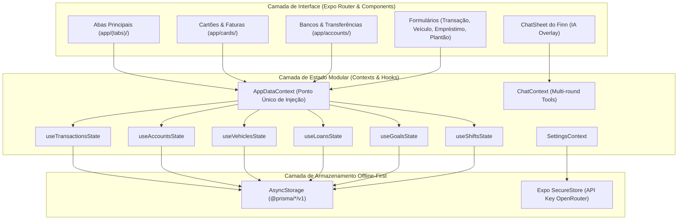

# 🗺️ Mapa de Arquitetura e Rotas: Projeto Prisma

Este documento serve como mapa de referência rápida para navegação no código, rotas de telas, fluxo de estado e persistência do **Prisma** (anteriormente chamado "Bolso").

---

## 🏗️ 1. Diagrama de Arquitetura Geral



---

## 📱 2. Mapa de Rotas e Telas (`artifacts/mobile/app/`)

### Abas Principais (`app/(tabs)/`)
*   `index.tsx`: **Tela Inicial (Dashboard Geral)** — Saldos em contas, resumo de cartões, atalhos rápidos e compromissos do dia.
*   `finance.tsx`: **Finanças** — Balanço do período, extrato de transações com filtros, análise de gastos por categoria/origem.
*   `vehicles.tsx`: **Veículos** — Lista de veículos, odômetro atual, KM/L médio por trechos e alertas de manutenção/óleo.
*   `loans.tsx`: **Empréstimos** — Contatos, agenda de vencimentos, saldos a receber/pagar e extratos.
*   `goals.tsx`: **Metas** — Objetivos de economia, simulação de rendimentos e aportes.
*   `shifts.tsx`: **Plantões** — Calendário mensal de turnos, escalas de serviço, cálculo de horas e recebimento de plantões.

### Módulo de Cartões de Crédito & Faturas (`app/cards/`)
*   `[id].tsx`: **Detalhes do Cartão & Faturas** — Hero com fatura do mês em destaque, dívida total parcelada, barra de limite, carrossel de faturas mês a mês, lista de compras e opção de desfazer importação.
*   `import.tsx`: **Importador de Faturas via IA** — Upload de PDF/imagem, leitura OCR via OpenRouter, conciliação de pagamentos antigos e lançamento de parcelas futuras.

### Módulo de Contas Bancárias & Transferências (`app/accounts/`)
*   `index.tsx`: **Bancos e Carteira** — Lista de contas correntes, poupanças e cartões com saldos e faturas atuais.
*   `[id].tsx`: **Editar Conta** — Configuração de nome, cor, saldo inicial e dia de fechamento/vencimento (para cartões).
*   `transfer.tsx`: **Transferência entre Contas** — Movimentação de saldo entre bancos ou pagamento de fatura de cartão (sem virar despesa de extrato).

### Telas Auxiliares e Modais
*   `transaction/[id].tsx` e `new.tsx`: Detalhe, edição e cadastro de transação (com suporte a parcelamento e seleção de conta).
*   `recurring/index.tsx`, `new.tsx` e `[id].tsx`: Despesas/receitas fixas que se repetem todo mês.
*   `fueling/[id].tsx` e `oilchange/[id].tsx`: Registro de abastecimento e troca de óleo para veículos.
*   `history.tsx`: Extrato financeiro completo com busca textual e filtros de período/conta.
*   `analysis.tsx`: "Para onde vai o dinheiro" — Gráficos de rosca e barras mês a mês.
*   `categories.tsx`: Gestão de categorias de receitas e despesas.
*   `settings.tsx`: Configurações de IA (OpenRouter), modelo ativo, backup/restauração e tema.

---

## 🗄️ 3. Mapa de Estado e Chaves de Persistência

Todas as chaves utilizam o prefixo `@prisma/*/v1` (gerenciadas em `lib/storage.ts`):

| Hook de Estado | Chaves no AsyncStorage | Entidades Armazenadas |
| :--- | :--- | :--- |
| `useTransactionsState` | `@prisma/transactions/v1`<br>`@prisma/categories/v1`<br>`@prisma/recurring/v1` | Transações, categorias e gastos recorrentes. |
| `useAccountsState` | `@prisma/accounts/v1`<br>`@prisma/transfers/v1`<br>`@prisma/card_imports/v1` | Contas/cartões, transferências e histórico de importações de fatura. |
| `useVehiclesState` | `@prisma/vehicles/v1`<br>`@prisma/fuelings/v1`<br>`@prisma/oil_changes/v1`<br>`@prisma/vehicle_reminders/v1` | Veículos, abastecimentos, trocas de óleo e lembretes (IPVA, revisão). |
| `useLoansState` | `@prisma/loans/v1`<br>`@prisma/loan_contacts/v1`<br>`@prisma/loan_payments/v1` | Empréstimos, contatos de devedores/credores e pagamentos parciais. |
| `useGoalsState` | `@prisma/goals/v1`<br>`@prisma/goal_deposits/v1` | Metas de economia e histórico de depósitos/aportes. |
| `useShiftsState` | `@prisma/shifts/v1`<br>`@prisma/shift_rules/v1` | Plantões gerados e regras de escala recorrente. |
| `useSettings` | `@prisma/settings/v1`<br>`expo-secure-store` | Preferências do app e chave privada da API OpenRouter. |

---

## 🧠 4. Mapa da Inteligência Artificial (Finn)

Localização: `artifacts/mobile/lib/ai/`

```
lib/ai/
├── systemPrompt.ts      # Persona proativa, regras de resposta e instruções
├── toolDefinitions.ts   # Schemas JSON das ferramentas expostas ao modelo
├── toolTypes.ts         # Tipos TypeScript das chamadas de ferramentas
└── handlers/            # Execução de ferramentas isolada por domínio:
    ├── transaction.ts   # add_transaction, list_transactions, get_summary
    ├── card.ts          # get_card_invoice, summarizeCards
    ├── vehicle.ts       # get_vehicle_stats, add_fueling
    ├── loan.ts          # list_loans, add_loan_payment
    ├── goal.ts          # list_goals, add_goal_deposit
    ├── shift.ts         # get_shifts, mark_shift_paid
    └── briefing.ts      # get_morning_briefing (resumo matinal integrado)
```

O `ChatContext` orquestra até **4 rodadas consecutivas** de requisição de ferramentas para responder de forma completa ao usuário.
